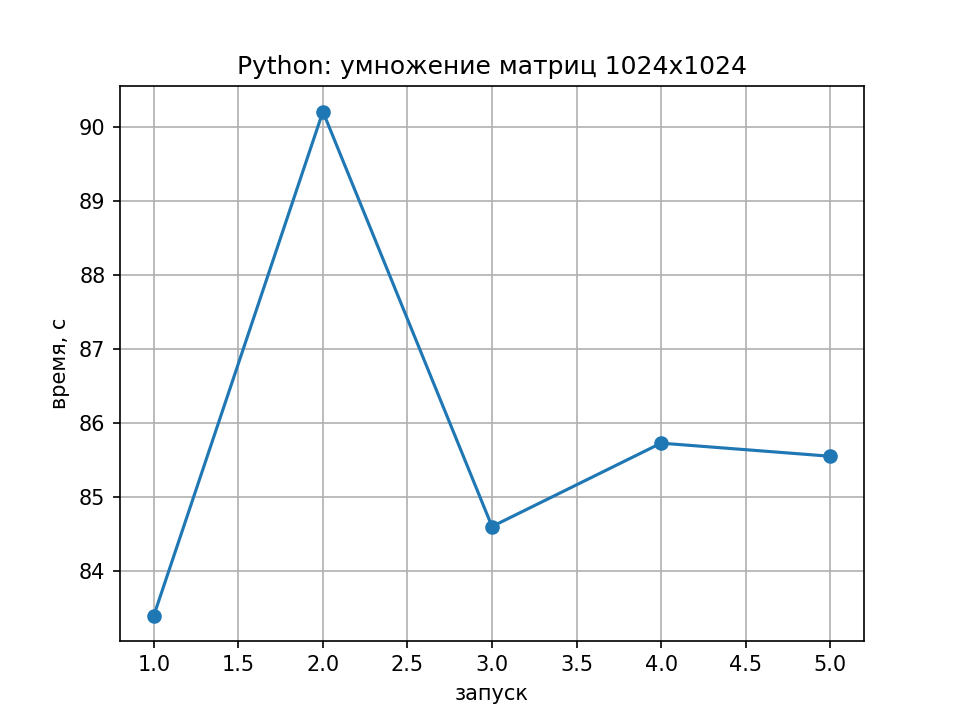

# Пункт 2

#### Результаты измерений (`python-matmul.csv`)

| Запуск (`run`) | Время выполнения (`seconds`), с | Производительность (`gflops`), GFLOPS |
| :---: | :---: | :---: |
| 1 | 83.390 | 0.0258 |
| 2 | 90.211 | 0.0238 |
| 3 | 84.596 | 0.0254 |
| 4 | 85.724 | 0.0251 |
| 5 | 85.547 | 0.0251 |

### Cтатистика
- **Медианное время:** **85.547 с**
- **Медианная производительность:** **0.0251 GFLOPS** (~25.1 MFLOPS)
- **Среднее время:** 85.893 с
- **Диапазон времени (min / max):** 83.390 с / 90.211 с

---

#### График времени выполнения

---

### Вопросы
- Так как у нас 3 вложенных цикла, то общее число итераций равняется $n^3$, из чего следует, что алгоритм имеет кубическую временную сложность $O(n^3)$.
 А при увеличении размера матрицы с 256 до 1024, получаем $$\left(\frac{1024}{256}\right)^3 = (4)^3 = 64$$, из=за чего и получается, что оценка получается умножением на 64.
- Общее количество операций при умножение матриц 1024x1024 равняется $(1024^3) * 2$ = 2147483648

