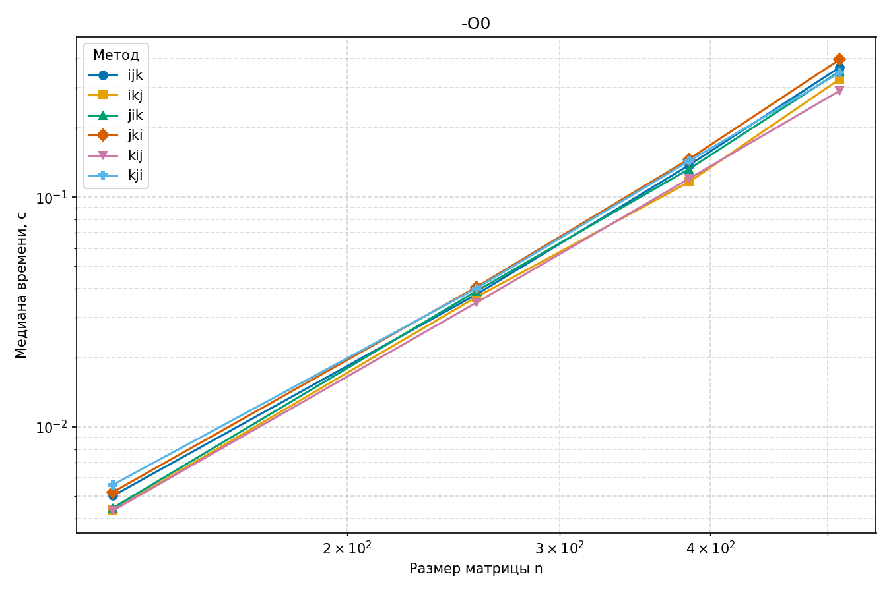
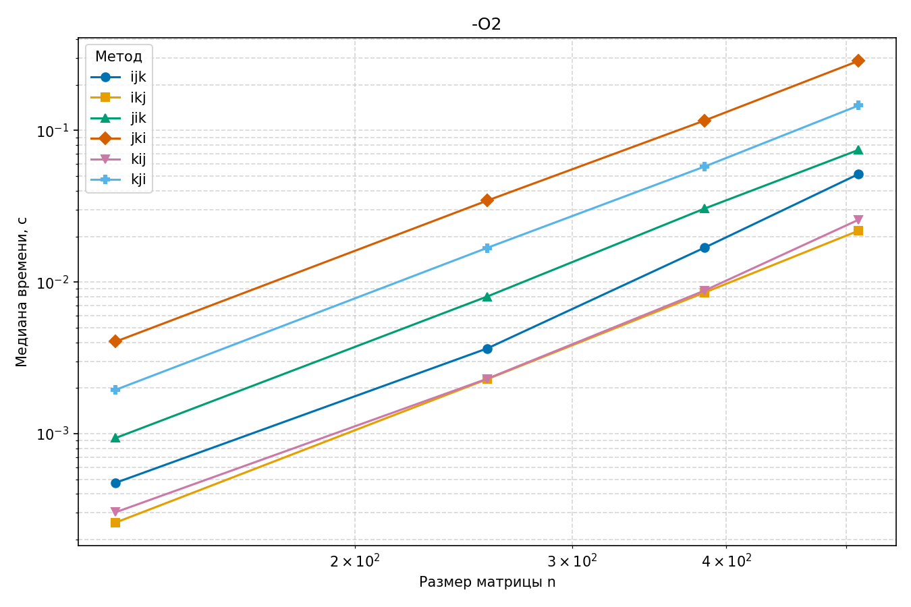
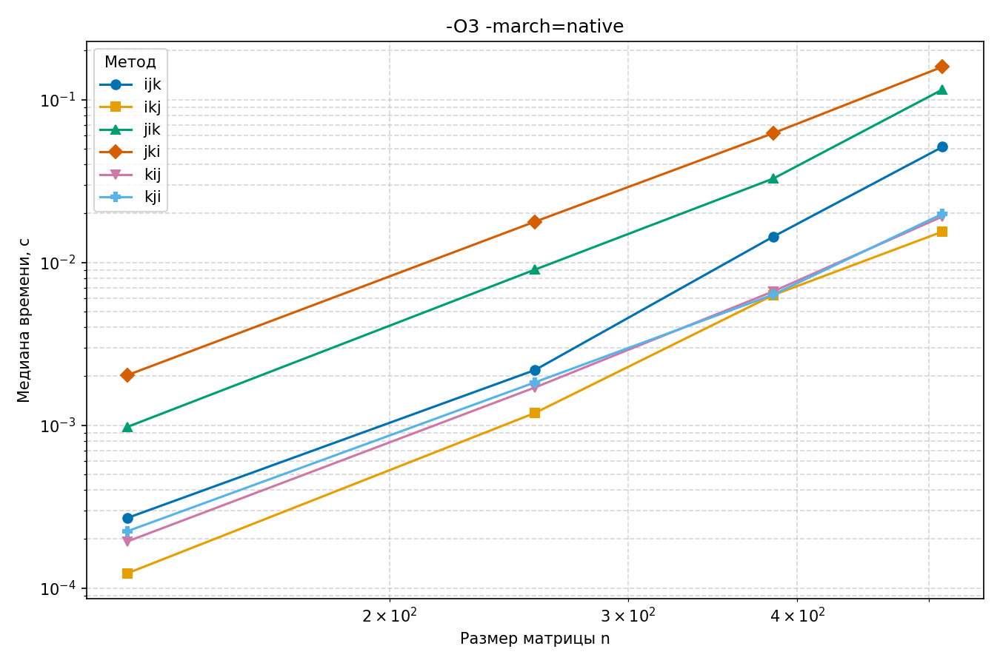

# Пункт 3

#### Проверка корректности (столбец `control`)
Во всех трёх файлах замеров для каждого размера матрицы $n$ значения `control` совпадают во всех шести порядках обхода на всех 5 прогонах:
- При $n = 128$: `36.143350609`
- При $n = 256$: `63.283563177`
- При $n = 384$: `94.155847599`
- При $n = 512$: `128.735066262`

---

#### Результаты измерений

##### Оптимизация `-O0` (`matmul_O0.csv`)
| Метод | n=128 (с / GFLOPS) | n=256 (с / GFLOPS) | n=384 (с / GFLOPS) | n=512 (с / GFLOPS) |
| :---: | :---: | :---: | :---: | :---: |
| `ijk` | 0.0050 с / 0.84 | 0.0377 с / 0.89 | 0.1377 с / 0.82 | 0.3673 с / 0.73 |
| `ikj` | 0.0043 с / 0.96 | 0.0367 с / 0.91 | 0.1163 с / 0.97 | 0.3264 с / 0.82 |
| `jik` | 0.0044 с / 0.94 | 0.0390 с / 0.86 | 0.1325 с / 0.85 | 0.3531 с / 0.76 |
| `jki` | 0.0052 с / 0.81 | 0.0406 с / 0.83 | 0.1463 с / 0.77 | 0.3974 с / 0.68 |
| `kij` | 0.0043 с / 0.97 | 0.0348 с / 0.96 | 0.1203 с / 0.94 | 0.2906 с / 0.92 |
| `kji` | 0.0056 с / 0.75 | 0.0401 с / 0.84 | 0.1436 с / 0.79 | 0.3483 с / 0.77 |

##### Оптимизация `-O2` (`matmul.csv`)
| Метод | n=128 (с / GFLOPS) | n=256 (с / GFLOPS) | n=384 (с / GFLOPS) | n=512 (с / GFLOPS) |
| :---: | :---: | :---: | :---: | :---: |
| `ijk` | 0.0005 с / 8.85 | 0.0036 с / 9.20 | 0.0169 с / 6.72 | 0.0516 с / 5.20 |
| `ikj` | 0.0003 с / 16.21 | 0.0023 с / 14.67 | 0.0085 с / 13.28 | 0.0218 с / 12.30 |
| `jik` | 0.0009 с / 4.48 | 0.0080 с / 4.18 | 0.0305 с / 3.71 | 0.0745 с / 3.60 |
| `jki` | 0.0040 с / 1.04 | 0.0345 с / 0.97 | 0.1163 с / 0.97 | 0.2881 с / 0.93 |
| `kij` | 0.0003 с / 13.87 | 0.0023 с / 14.58 | 0.0088 с / 12.90 | 0.0258 с / 10.41 |
| `kji` | 0.0019 с / 2.15 | 0.0168 с / 2.00 | 0.0578 с / 1.96 | 0.1461 с / 1.84 |

##### Оптимизация `-O3 -march=native` (`matmul_O3.csv`)
| Метод | n=128 (с / GFLOPS) | n=256 (с / GFLOPS) | n=384 (с / GFLOPS) | n=512 (с / GFLOPS) |
| :---: | :---: | :---: | :---: | :---: |
| `ijk` | 0.0003 с / 15.57 | 0.0022 с / 15.39 | 0.0144 с / 7.86 | 0.0512 с / 5.24 |
| `ikj` | 0.0001 с / 34.18 | 0.0012 с / 28.24 | 0.0063 с / 17.97 | 0.0155 с / 17.36 |
| `jik` | 0.0010 с / 4.30 | 0.0090 с / 3.72 | 0.0327 с / 3.46 | 0.1153 с / 2.33 |
| `jki` | 0.0020 с / 2.07 | 0.0178 с / 1.89 | 0.0622 с / 1.82 | 0.1591 с / 1.69 |
| `kij` | 0.0002 с / 21.74 | 0.0017 с / 19.69 | 0.0066 с / 17.05 | 0.0192 с / 14.02 |
| `kji` | 0.0002 с / 18.79 | 0.0018 с / 18.32 | 0.0063 с / 17.86 | 0.0199 с / 13.50 |

### Cтатистика
- **Самый быстрый порядок:** `ikj` (достигает **34.18 GFLOPS** при `-O3 -march=native`).
- **Самый медленный порядок:** `jki` (производительность падает до 0.93 GFLOPS при `-O2`).
---

#### Графики времени выполнения

##### График для `-O0`


##### График для `-O2`


##### График для `-O3 -march=native`


---

### Вопросы

- В методе `ijk` внутренний цикл изменяет индекс строки $k$, поэтому элементы матрицы $b$ считываются с шагом в целую строку при обращении к элементам одного столбца ($b[k][j]$).
- В методе `ikj` внутренний цикл изменяет индекс столбца $j$, благодаря чему элементы матрицы $b$ читаются из памяти последовательно подряд вдоль текущей строки ($b[k][j]$).

  **Метод `ijk`:**
  ```assembly
  .L4:
      movsd     xmm0, QWORD PTR [rdx]          
      add       rax, 6144                      # смещение на 6144 байт 
      add       rdx, 8                         # шаг к следующему double в строке a 
      unpcklpd  xmm0, xmm0
      mulpd     xmm0, XMMWORD PTR -6144[rax]   # чтение b[k][j] с шагом в целую строку
      addpd     xmm1, xmm0                     # накопление суммы
      cmp       rax, rcx
      jne       .L4
  ```

  **Метод `ikj`:**
  ```assembly
  .L25:
      movapd    xmm0, XMMWORD PTR [rcx+rax]    # чтение b[k][j..j+1] последовательно подряд вдоль строки
      mulpd     xmm0, xmm1                     # умножение на a[i][k] из регистра xmm1
      addpd     xmm0, XMMWORD PTR [rdx+rax]    # прибавление к c[i][j..j+1] подряд из памяти
      movaps    XMMWORD PTR [rdx+rax], xmm0    # сохранение c[i][j..j+1] подряд в память
      add       rax, 16                        # шаг на 16 байт
      cmp       r8, rax
      jne       .L25
  ```

