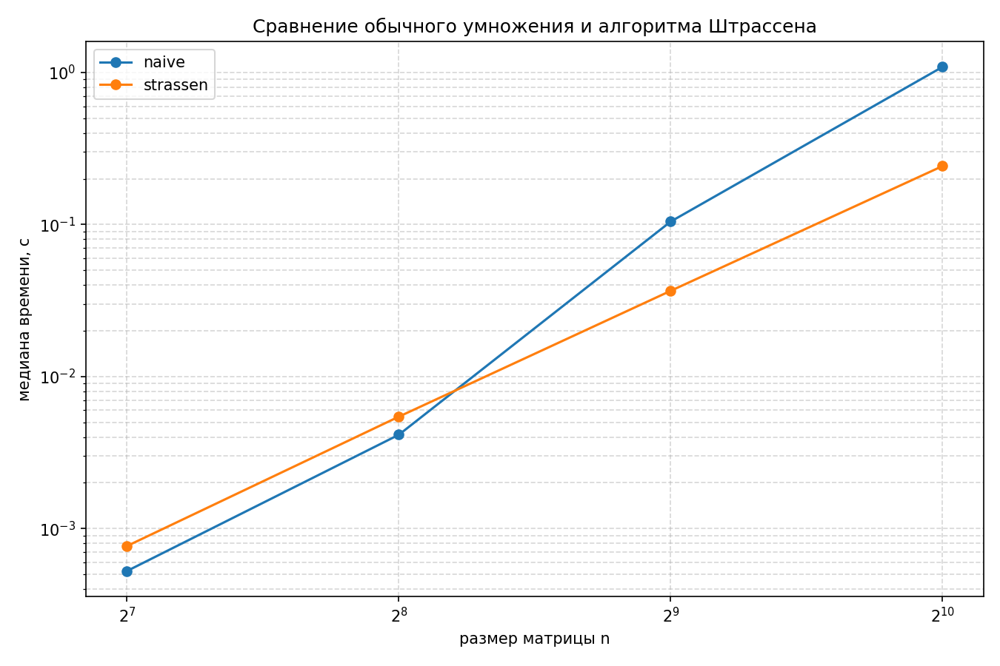

# Пункт 5

#### Сводные результаты измерений

| Размер n | Время `naive` , с | Время `strassen` , с | Ускорение Штрассена | `maxdiff` |
| :---: | :---: | :---: | :---: | :---: |
| 128 | 0.000526 | 0.000768 | 0.69×  | 8.527e-14 |
| 256 | 0.004143 | 0.005448 | 0.76× | 3.268e-13 |
| 512 | 0.104634 | 0.036651 | **2.85×**  | 1.336e-12 |
| 1024 | 1.089110 | 0.242490 | **4.49×** | 6.139e-12 |

### Cтатистика
- **Порог эффективности:** алгоритм Штрассена обгоняет naive при $n \approx 320 \dots 350$.
- **Малые матрицы ($n \le 256$):** naive алгоритм быстрее на 30–46% из-за накладных расходов Штрассена на рекурсию и выделение памяти (`malloc`).
- **Большие матрицы ($n \ge 512$):** алгоритм Штрассена быстрее в **2.85 раза** при $n = 512$ и в **4.49 раза** при $n = 1024$ (0.242 с против 1.089 с).
- **Точность вычислений (`maxdiff`):** максимальная погрешность составляет от $8.527 \times 10^{-14}$ до $6.139 \times 10^{-12}$.

---

#### График времени выполнения

---
